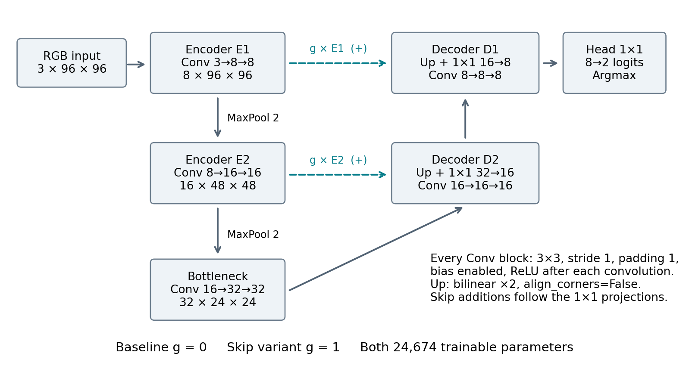

# Reproducible Pet Segmentation with Additive Skip Fusion

**Bhaskar Sahu · Roll number 23115023 · Advanced Computer Vision · Batch 2027**

> Student identity: Bhaskar Sahu (23115023). The experiment seed remains `23115002` throughout the recorded protocol and artifacts; it is an experimental setting, not the student roll number.

This project asks a simple question: **can a small segmentation network make better predictions when the decoder can reuse features from the encoder?** To answer it, the experiment compares two versions of the same network on the Oxford-IIIT Pet dataset. One is a basic encoder–decoder. The other adds two skip connections that pass encoder features into the decoder.

The comparison deliberately keeps the rest of the setup fixed. Both networks start with the same weights, see the same training examples and augmentations, and receive the same number of optimizer updates. This makes the results easier to interpret: the architectural change being tested is additive skip fusion.

The skip model achieved **71.76% test mIoU**, compared with **70.55%** for the baseline. That is an improvement of **1.21 percentage points** on the selected 740-image test subset. The result is encouraging within this setup, although one training seed is not enough to claim that skip fusion will always perform better.

## Start here

The report, code and saved evidence can be reviewed without running the experiment. The report contains the supplied customized text, with technical corrections, formatted tables, architecture diagrams, plots and labelled evidence screenshots. Review the final wording and figures before submission.

| What you want to see | Where to find it |
The submission archive, `Bhaskar_Sahu_23115023_submission.zip`, contains the report, source code, trained checkpoints, logs, figures, screenshots and environment records. The report is named for Bhaskar Sahu (roll number 23115023) and is included in PDF and editable Word formats. Open the PDF and check it before uploading. The full dataset is downloaded separately when reproducing the experiment.

## 1. What the project does

Semantic segmentation assigns a label to each pixel in an image. In this project, the network decides whether each evaluated pixel belongs to the pet or the background. It does not predict the animal's breed.

A basic encoder–decoder first reduces spatial resolution to learn image features and then upsamples those features to produce a mask. This is useful for understanding the image as a whole, but some spatial detail can be lost during downsampling. Skip connections give the decoder access to earlier features at matching resolutions. The experiment tests whether that additional information improves the predicted pet region.

The model is small enough to train on a laptop CPU. The aim is a transparent, reproducible comparison with evidence for each stage of the experiment.

## 2. Plan of action

The work follows six stages:

1. **Define the data contract.** Decide how images, labels, ignored regions and splits will be handled, then save the chosen image IDs.
2. **Build the baseline.** Implement a compact encoder–decoder and fix its training settings before evaluating the test set.
3. **Introduce one change.** Enable additive skip fusion while preserving the model's parameter shapes and training schedule.
4. **Train and select checkpoints.** Run both models for 20 epochs and retain the checkpoint with the highest validation mIoU.
5. **Collect evidence.** Measure test IoU, parameter count and inference latency, then inspect matched examples and failures.
6. **Verify and document.** Re-evaluate the saved checkpoints, check the metric implementation, and assemble the report and submission files.


## 3. Dataset and label handling

The experiment uses Oxford-IIIT Pet photographs and their provided human trimaps. The official annotation archive supplies the masks and split lists. RGB images come from the timm mirror, joined to the masks by their original image IDs.

### Choosing the splits

The official `trainval.txt` and `test.txt` lists define separate source pools. A seeded shuffle selects examples within each of the 37 breeds:

| Split | Source pool | Images per breed | Total images | Purpose |
|---|---|---:|---:|---|
| Training | Official trainval | 40 | 1,480 | Update model weights |
| Validation | Official trainval | 10 | 370 | Select the saved checkpoint |
| Test | Official test | 20 | 740 | Measure held-out performance |

The remaining official examples are unused. These scores therefore describe a **declared subset experiment**, rather than a full-dataset benchmark. Breed balancing spreads the examples across the dataset; the segmentation outputs remain just background and pet.


### Mapping the trimap labels

| Original mask value | Meaning | Target value | Treatment |
|---:|---|---:|---|
| 1 | Pet foreground | 1 | Included in loss and IoU |
| 2 | Background | 0 | Included in loss and IoU |
| 3 | Uncertain boundary | 255 | Excluded from loss and IoU |

The ignored boundary is not a third predicted class. The model produces a prediction everywhere, but a prediction at a ground-truth pixel marked `255` does not affect the loss or score.

### Image and mask transforms

Images are converted to RGB, resized directly to **96 × 96** with bilinear interpolation, converted to float32 and divided by 255. Masks are resized with **nearest-neighbour interpolation** so that resizing does not create intermediate label values.

Only training examples receive augmentation: a horizontal flip with probability 0.5, applied to the image and its mask together. Validation and test examples are evaluated without augmentation. There is no pretrained normalization or aspect-preserving crop; the direct square resize can distort the original proportions.

The [data manifest](artifacts/data_manifest.json) includes image and mask hashes. [Archive hashes](artifacts/archive_hashes.json) identify the downloaded source files. The image mirror is pinned to revision `089695c834a7deb60505b7cc506672db1c31a6aa`.

## 4. Architecture and controlled change



Each convolution block contains two 3 × 3 convolutions with stride 1, padding 1, biases and a ReLU after each convolution. Two max-pooling operations reduce the resolution. The decoder uses bilinear upsampling and 1 × 1 projections to restore the required feature widths.

| Block | Channels | Output shape per image | Trainable parameters |
|---|---|---|---:|
| Encoder E1 | 3 → 8 → 8 | 8 × 96 × 96 | 808 |
| Encoder E2 | 8 → 16 → 16 | 16 × 48 × 48 | 3,488 |
| Bottleneck | 16 → 32 → 32 | 32 × 24 × 24 | 13,888 |
| Projection P2 | 32 → 16 | 16 × 48 × 48 | 528 |
| Decoder D2 | 16 → 16 → 16 | 16 × 48 × 48 | 4,640 |
| Projection P1 | 16 → 8 | 8 × 96 × 96 | 136 |
| Decoder D1 | 8 → 8 → 8 | 8 × 96 × 96 | 1,168 |
| Output head | 8 → 2 | 2 × 96 × 96 | 18 |
| **Total** | | | **24,674** |

The baseline sends each projected, upsampled tensor straight into its decoder block. The skip variant first adds the matching encoder tensor:

```text
Baseline: decoder_input = projected_upsampled_features
Skip:     decoder_input = projected_upsampled_features + encoder_features
```

There are two such additions, at 48 × 48 and 96 × 96. Addition introduces no new trainable weights, so both variants have exactly the same parameter shapes and count. The same seed therefore gives them identical initial weights.

The network is inspired by the encoder–decoder structure of U-Net, but uses a much smaller architecture and additive fusion rather than concatenation. It has no batch normalization, dropout, dilation, global pooling or boundary branch. The complete implementation is in [model.py](src/model.py).

## 5. Training settings

| Setting | Value used for both models |
|---|---|
| Seed | 23115002 |
| Input size | 96 × 96 RGB |
| Initialization | Default PyTorch convolution initialization; no pretraining |
| Optimizer | Adam |
| Learning rate | 0.001 |
| Adam betas and epsilon | (0.9, 0.999), epsilon 1e-8 |
| Weight decay | 0 |
| Batch size | 16; the final batch contains 8 images |
| Training budget | 20 epochs, 93 batches per epoch, 1,860 updates |
| Loss | Cross entropy with `ignore_index=255` |
| Checkpoint selection | Highest validation global mIoU; earliest epoch if tied |
| Execution | CPU, float32, four PyTorch threads |
| Other settings | Deterministic algorithms enabled; no scheduler or mixed precision |
 
Both runs stop after epoch 20, even if an earlier checkpoint has the best validation score. The baseline's selected checkpoint is from **epoch 19**; the skip model's is from **epoch 20**. Test scores are calculated after training and do not decide which checkpoint is retained.

## 6. Results and what they mean

| Measure | Baseline | Additive skip |
|---|---:|---:|
| Background IoU | 78.25% | 80.04% |
| Pet IoU | 62.85% | 63.48% |
| Mean IoU | **70.55%** | **71.76%** |
| Trainable parameters | 24,674 | 24,674 |
| Optimizer updates | 1,860 | 1,860 |
| Selected epoch | 19 | 20 |
| Total training time | 279.9 s | 329.6 s |
| Median CPU forward latency | 1.350 ms | 1.430 ms |
| p95 CPU forward latency | 1.413 ms | 1.465 ms |

The modified model improves both class IoUs, with a larger improvement for background. Looking at the confusion matrices helps explain the tradeoff: false pet predictions on background fall from **484,703 to 352,442** pixels, while missed pet pixels rise from **464,153 to 531,816**. The skip model is more conservative about predicting foreground. Its reduction in false positives is enough to improve the final IoUs despite the additional missed foreground pixels.

This is a useful result, but it should be read at the scale of the experiment. The networks have equal parameters and training updates; they do not have exactly equal computation, memory traffic or measured running time.
 
