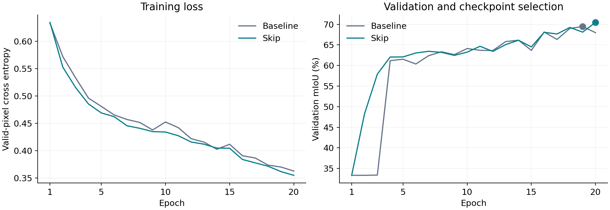
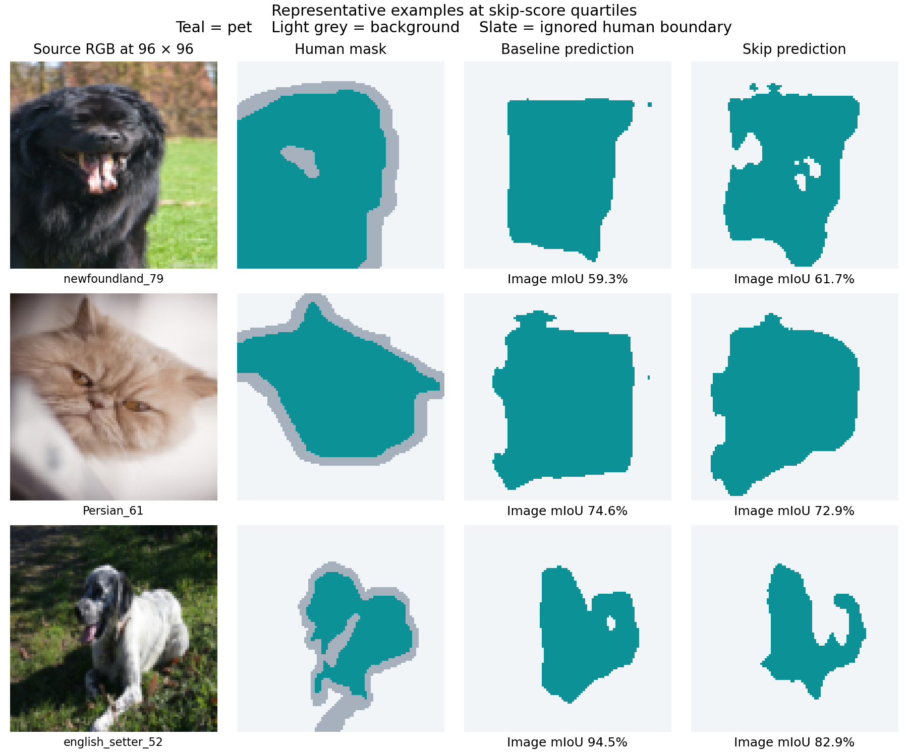
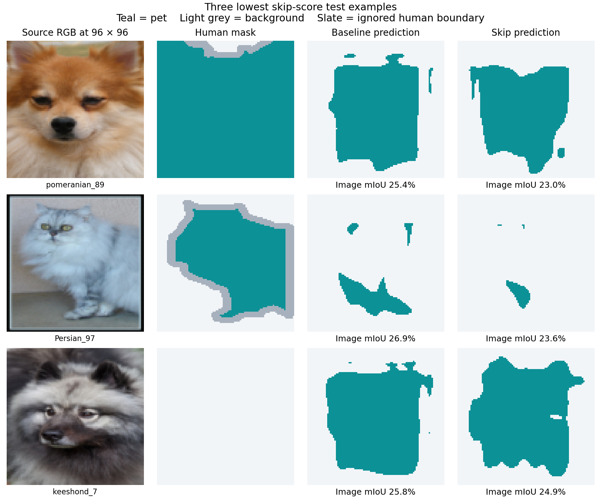

# Reproducible Pet Segmentation with Additive Skip Fusion

**Abhay Kumar · Roll number 23115002 · Advanced Computer Vision · Batch 2027**

This project asks a simple question: **can a small segmentation network make better predictions when the decoder can reuse features from the encoder?** To answer it, the experiment compares two versions of the same network on the Oxford-IIIT Pet dataset. One is a basic encoder–decoder. The other adds two skip connections that pass encoder features into the decoder.

The comparison deliberately keeps the rest of the setup fixed. Both networks start with the same weights, see the same training examples and augmentations, and receive the same number of optimizer updates. This makes the results easier to interpret: the architectural change being tested is additive skip fusion.

The skip model achieved **71.76% test mIoU**, compared with **70.55%** for the baseline. That is an improvement of **1.21 percentage points** on the selected 740-image test subset. The result is encouraging within this setup, although one training seed is not enough to claim that skip fusion will always perform better.

## Start here

The report, code and saved evidence can be reviewed without running the experiment. The report contains the supplied customized text, with technical corrections, formatted tables, architecture diagrams, plots and labelled evidence screenshots. Review the final wording and figures before submission.

| What you want to see | Where to find it |
|---|---|
| Project report PDF | [23115002.pdf](report/23115002.pdf) |
| Editable report | [23115002.docx](report/23115002.docx) |
| Plan of action | [PLAN_OF_ACTION.md](PLAN_OF_ACTION.md) |
| Submission instructions | [SUBMISSION.md](SUBMISSION.md) |
| Exact measured results | [results.json](artifacts/results.json) |
| Training and evaluation screenshots | [Execution screenshot](artifacts/screenshots/execution.png) and [evaluation screenshot](artifacts/screenshots/metrics.png) |
| Reproduction commands | The execution instructions below, or [reproduce.sh](reproduce.sh) |

**Repository:** [github.com/abhikhurannah/ACV](https://github.com/abhikhurannah/ACV)

The submission archive, `23115002_submission.zip`, contains the report, source code, trained checkpoints, logs, figures, screenshots and environment records. The report is named 23115002 and is included in PDF and editable Word formats. Open the PDF and check it before uploading. The full dataset is downloaded separately when reproducing the experiment.

## 1. What the project does

Semantic segmentation assigns a label to each pixel in an image. In this project, the network decides whether each evaluated pixel belongs to the pet or the background. It does not predict the animal's breed.

A basic encoder–decoder first reduces spatial resolution to learn image features and then upsamples those features to produce a mask. This is useful for understanding the image as a whole, but some spatial detail can be lost during downsampling. Skip connections give the decoder access to earlier features at matching resolutions. The experiment tests whether that additional information improves the predicted pet region.

The model is small enough to train on a laptop CPU. The aim is a transparent, reproducible comparison with evidence for each stage of the experiment.

## 2. Plan of action

The work follows six stages:

1. **Define the data contract.** Decide how images, labels, ignored regions and splits will be handled, then save the chosen image IDs.
2. **Build the baseline.** Implement a compact encoder–decoder and fix its training settings before evaluating the test set.
3. **Introduce one change.** Enable additive skip fusion while preserving the model's parameter shapes and training schedule.
4. **Train and select checkpoints.** Run both models for 20 epochs and retain the checkpoint with the highest validation mIoU.
5. **Collect evidence.** Measure test IoU, parameter count and inference latency, then inspect matched examples and failures.
6. **Verify and document.** Re-evaluate the saved checkpoints, check the metric implementation, and assemble the report and submission files.

The [full plan](PLAN_OF_ACTION.md) records the comparison budget and expected outputs.

## 3. Dataset and label handling

The experiment uses Oxford-IIIT Pet photographs and their provided human trimaps. The official annotation archive supplies the masks and split lists. RGB images come from the timm mirror, joined to the masks by their original image IDs.

### Choosing the splits

The official `trainval.txt` and `test.txt` lists define separate source pools. A seeded shuffle selects examples within each of the 37 breeds:

| Split | Source pool | Images per breed | Total images | Purpose |
|---|---|---:|---:|---|
| Training | Official trainval | 40 | 1,480 | Update model weights |
| Validation | Official trainval | 10 | 370 | Select the saved checkpoint |
| Test | Official test | 20 | 740 | Measure held-out performance |

The remaining official examples are unused. These scores therefore describe a **declared subset experiment**, rather than a full-dataset benchmark. Breed balancing spreads the examples across the dataset; the segmentation outputs remain just background and pet.

The split seed is `23115002`. Every selected ID is saved in [splits.json](artifacts/splits.json). Automated checks confirm that the three partitions do not overlap and that each image comes from the correct official pool.

### Mapping the trimap labels

| Original mask value | Meaning | Target value | Treatment |
|---:|---|---:|---|
| 1 | Pet foreground | 1 | Included in loss and IoU |
| 2 | Background | 0 | Included in loss and IoU |
| 3 | Uncertain boundary | 255 | Excluded from loss and IoU |

The ignored boundary is not a third predicted class. The model produces a prediction everywhere, but a prediction at a ground-truth pixel marked `255` does not affect the loss or score.

### Image and mask transforms

Images are converted to RGB, resized directly to **96 × 96** with bilinear interpolation, converted to float32 and divided by 255. Masks are resized with **nearest-neighbour interpolation** so that resizing does not create intermediate label values.

Only training examples receive augmentation: a horizontal flip with probability 0.5, applied to the image and its mask together. Validation and test examples are evaluated without augmentation. There is no pretrained normalization or aspect-preserving crop; the direct square resize can distort the original proportions.

The [data manifest](artifacts/data_manifest.json) includes image and mask hashes. [Archive hashes](artifacts/archive_hashes.json) identify the downloaded source files. The image mirror is pinned to revision `089695c834a7deb60505b7cc506672db1c31a6aa`.

## 4. Architecture and controlled change


Each convolution block contains two 3 × 3 convolutions with stride 1, padding 1, biases and a ReLU after each convolution. Two max-pooling operations reduce the resolution. The decoder uses bilinear upsampling and 1 × 1 projections to restore the required feature widths.

| Block | Channels | Output shape per image | Trainable parameters |
|---|---|---|---:|
| Encoder E1 | 3 → 8 → 8 | 8 × 96 × 96 | 808 |
| Encoder E2 | 8 → 16 → 16 | 16 × 48 × 48 | 3,488 |
| Bottleneck | 16 → 32 → 32 | 32 × 24 × 24 | 13,888 |
| Projection P2 | 32 → 16 | 16 × 48 × 48 | 528 |
| Decoder D2 | 16 → 16 → 16 | 16 × 48 × 48 | 4,640 |
| Projection P1 | 16 → 8 | 8 × 96 × 96 | 136 |
| Decoder D1 | 8 → 8 → 8 | 8 × 96 × 96 | 1,168 |
| Output head | 8 → 2 | 2 × 96 × 96 | 18 |
| **Total** | | | **24,674** |

The baseline sends each projected, upsampled tensor straight into its decoder block. The skip variant first adds the matching encoder tensor:

```text
Baseline: decoder_input = projected_upsampled_features
Skip:     decoder_input = projected_upsampled_features + encoder_features
```

There are two such additions, at 48 × 48 and 96 × 96. Addition introduces no new trainable weights, so both variants have exactly the same parameter shapes and count. The same seed therefore gives them identical initial weights.

The network is inspired by the encoder–decoder structure of U-Net, but uses a much smaller architecture and additive fusion rather than concatenation. It has no batch normalization, dropout, dilation, global pooling or boundary branch. The complete implementation is in [model.py](src/model.py).

## 5. Training settings

| Setting | Value used for both models |
|---|---|
| Seed | 23115002 |
| Input size | 96 × 96 RGB |
| Initialization | Default PyTorch convolution initialization; no pretraining |
| Optimizer | Adam |
| Learning rate | 0.001 |
| Adam betas and epsilon | (0.9, 0.999), epsilon 1e-8 |
| Weight decay | 0 |
| Batch size | 16; the final batch contains 8 images |
| Training budget | 20 epochs, 93 batches per epoch, 1,860 updates |
| Loss | Cross entropy with `ignore_index=255` |
| Checkpoint selection | Highest validation global mIoU; earliest epoch if tied |
| Execution | CPU, float32, four PyTorch threads |
| Other settings | Deterministic algorithms enabled; no scheduler or mixed precision |

A separately seeded generator controls sample order and flip decisions. Resetting it for each run gives both models the same sequence of examples and augmentations. The checks also record hashes of the shared initialization and schedule in [controlled_comparison.json](artifacts/controlled_comparison.json).

Both runs stop after epoch 20, even if an earlier checkpoint has the best validation score. The baseline's selected checkpoint is from **epoch 19**; the skip model's is from **epoch 20**. Test scores are calculated after training and do not decide which checkpoint is retained.

## 6. Results and what they mean

| Measure | Baseline | Additive skip |
|---|---:|---:|
| Background IoU | 78.25% | 80.04% |
| Pet IoU | 62.85% | 63.48% |
| Mean IoU | **70.55%** | **71.76%** |
| Trainable parameters | 24,674 | 24,674 |
| Optimizer updates | 1,860 | 1,860 |
| Selected epoch | 19 | 20 |
| Total training time | 279.9 s | 329.6 s |
| Median CPU forward latency | 1.350 ms | 1.430 ms |
| p95 CPU forward latency | 1.413 ms | 1.465 ms |

The modified model improves both class IoUs, with a larger improvement for background. Looking at the confusion matrices helps explain the tradeoff: false pet predictions on background fall from **484,703 to 352,442** pixels, while missed pet pixels rise from **464,153 to 531,816**. The skip model is more conservative about predicting foreground. Its reduction in false positives is enough to improve the final IoUs despite the additional missed foreground pixels.

This is a useful result, but it should be read at the scale of the experiment. The networks have equal parameters and training updates; they do not have exactly equal computation, memory traffic or measured running time.



### How IoU is calculated

The evaluator sums a 2 × 2 confusion matrix over every valid test pixel. Rows are ground truth and columns are predictions, ordered background then pet.

```text
IoU(class) = true positives / (true positives + false positives + false negatives)
mIoU       = (background IoU + pet IoU) / 2
```

The reported score is calculated from the **global pixel totals**. It is not the average of individual-image mIoUs. Per-image values are saved separately to help choose and inspect examples. For that diagnostic calculation, a class with zero union has undefined IoU and is omitted from the image-level mean. Both classes have positive union in the global evaluation.

The exact evaluation implementation is [evaluate.py](src/evaluate.py), with metric helpers in [train.py](src/train.py). [results.json](artifacts/results.json) contains the full-precision scores, confusion matrices, checkpoint hashes and timing samples.

### How latency is measured

The recorded machine has an **Apple M2 CPU, 8 logical cores and 8 GiB RAM**, running macOS 27.0.1 arm64. The experiment uses Python 3.10.16, PyTorch 2.14.1 and NumPy 2.2.6.

Each latency measurement uses float32 CPU inference with four threads and a batch of one. The input tensor is already in memory and has shape `1 × 3 × 96 × 96`. After 30 warmup calls, 200 forward calls are timed individually with `time.perf_counter_ns()`.

These are model-forward timings. They exclude image decoding, resizing, transfers, argmax and metric calculation. Background processes and thermal state were not controlled, so the measurements describe this machine and session rather than a general application speed guarantee. The mean and all raw samples are available alongside the median and p95.

## 7. Looking beyond the average score



The representative examples are selected at the 25th, 50th and 75th percentiles of the skip model's per-image score ranking. Each row shows the same input and human mask beside both predictions. This makes local differences visible, including cases where the baseline does better on an individual image even though its overall score is lower.



The failure figure contains the three lowest-scoring test examples for the skip model:

- **`pomeranian_89`:** the human foreground mask covers almost the whole image, while both models predict a smaller central region.
- **`Persian_97`:** most of the cat is missed. The skip prediction retains only a small foreground patch.
- **`keeshond_7`:** the photograph visibly contains an animal, but the official mask contains only background. Predicted pet pixels are therefore scored as false positives.

The last case is especially useful when interpreting the results. A low overlap score can reflect a problem in the supplied annotation as well as a model mistake.

### Annotation audit

Four selected original trimaps contain only background:

| Split | Image IDs |
|---|---|
| Training | `Egyptian_Mau_165`, `miniature_pinscher_14` |
| Test | `keeshond_7`, `Persian_259` |

These examples remain in the frozen partitions. They were not removed after seeing the results. The [annotation audit](artifacts/annotation_audit.json) records the original pixel counts, and [audit_annotations.py](src/audit_annotations.py) reproduces that check.

## 8. Reproducing the experiment

You can either evaluate the included checkpoints or retrain both networks. The saved report and evidence can be inspected without installing the experiment environment.

### Set up the environment and data

Run the following commands from the project root. They use a Unix-style shell on macOS or Linux.

```bash
python3.10 -m venv .venv
source .venv/bin/activate
pip install -r requirements-lock.txt
python src/download.py
python src/prepare.py
python src/audit_annotations.py
python src/check_contract.py
```

On Windows, activate the environment with `.venv\Scripts\activate` instead of `source .venv/bin/activate`.

The downloads total approximately 810 MB. The downloader verifies their hashes against the supplied archive manifest. Preparation matches images to masks, recreates the selected splits and writes the resized arrays to `data/`. Exact installed package versions are in [requirements-lock.txt](requirements-lock.txt); [requirements.txt](requirements.txt) lists the core experiment dependencies.

### Option A — evaluate the supplied checkpoints

The two selected checkpoints are already included as `artifacts/baseline.pt` and `artifacts/skip.pt`. After preparing the data, run:

```bash
python src/evaluate.py --output verification_results.json
python tools/verify_results.py
```

The verification script compares the new accuracy measurements with the recorded results. It checks the class IoUs, global mIoU, confusion matrices, checkpoint hashes, selected epochs and update budget. It does not require latency samples to match, because timing naturally varies between runs.

The evaluator creates prediction arrays and refreshes the per-image score CSV. Prediction arrays are excluded from the submission because they can be regenerated from the included checkpoints. To keep the original submission files untouched, perform reproduction in a separate extracted copy of the archive.

### Option B — retrain both variants

```bash
python -u src/train.py --variant baseline > artifacts/baseline_train.log 2>&1
python -u src/train.py --variant skip > artifacts/skip_train.log 2>&1
python src/evaluate.py
python src/figures.py
python src/build_evidence.py
```

This sequence creates new checkpoints, training histories, predictions, figures and evidence pages. The training logs are written to files; use `tail -f artifacts/baseline_train.log` or `tail -f artifacts/skip_train.log` to follow a run.

For a complete run from environment setup through evidence-page generation, use:

```bash
bash reproduce.sh
```

Training took approximately five minutes per model in the recorded session. Another machine may take a different amount of time. Deterministic settings improve repeatability within the recorded environment, but do not guarantee bitwise-identical results across operating systems or PyTorch versions.

### Screenshots and report generation

[build_evidence.py](src/build_evidence.py) creates HTML views from the actual logs and measured results. [capture_evidence.cjs](src/capture_evidence.cjs) captures those pages using Playwright and Chrome. The included screenshots are genuine browser views of this evidence dashboard, clearly labelled as such in the report.

Screenshot capture is separate from model training. Install Playwright and use Google Chrome to run `src/capture_evidence.cjs`; set `PLAYWRIGHT_MODULE` and `CHROME_PATH` if their locations differ from your installation. The included captures can be inspected directly. The formatted report and editable Word document are included in report/.

## 9. Project layout

```text
ACV/
├── README.md                    Project explanation and reproduction guide
├── PLAN_OF_ACTION.md            Experiment plan and comparison budget
├── SUBMISSION.md                Guide to the submission files
├── DATA_ATTRIBUTION.md          Dataset and image attribution
├── requirements.txt             Core experiment dependencies
├── requirements-lock.txt        Full pinned Python environment
├── reproduce.sh                 Complete experiment execution sequence
├── report/
│   ├── 23115002.pdf             Final report PDF
│   └── 23115002.docx            Editable report
├── src/
│   ├── download.py              Download and verify source archives
│   ├── prepare.py               Create the frozen data splits and arrays
│   ├── audit_annotations.py     Identify masks without pet pixels
│   ├── model.py                 Baseline and additive-skip architecture
│   ├── train.py                 Fixed-budget training and metric helpers
│   ├── evaluate.py              Held-out evaluation and latency measurement
│   ├── check_contract.py        Data, initialization and metric checks
│   ├── figures.py               Plots and matched prediction panels
│   ├── build_evidence.py        Evidence dashboards from saved outputs
│   └── capture_evidence.cjs     Browser screenshot capture
├── artifacts/
│   ├── baseline.pt / skip.pt    Selected trained checkpoints
│   ├── *_train.log              Raw training logs
│   ├── *_history.json           Epoch losses and validation scores
│   ├── results.json             Test metrics and raw latency samples
│   ├── per_image.csv            Image-level diagnostic scores
│   ├── splits.json              Exact selected image IDs
│   ├── data_manifest.json       Per-image and mask hashes
│   ├── environment.json         Recorded training settings and versions
│   ├── hardware.json            Recorded CPU and memory conditions
│   ├── figures/                 Architecture, curves, examples and failures
│   ├── screenshots/             Included browser evidence captures
│   └── evidence/                Underlying HTML evidence pages
└── tools/                       Packaging and verification utilities
```

`data/` and `.venv/` are created locally during reproduction. They are excluded from Git and the submission archive. The ZIP includes a `SUBMISSION_SHA256.json` manifest for checking the integrity of its contents.

## 10. Checks completed

The submitted experiment passed checks for split sizes and disjointness, source-pool membership, image dimensions and allowed label values. Further checks confirm identical initial model weights, identical parameter shapes, a fixed sample-and-flip schedule, correct ignored-pixel handling and a hand-calculated IoU example.

An independent evaluation of both saved checkpoints reproduced the recorded class IoUs, global mIoUs and confusion matrices exactly. The selected epochs were checked against the highest validation scores, and both training histories contain all 20 epochs and 1,860 updates.

The report was rendered and every page was visually inspected. The submission archive was also checked for readable contents and matching file hashes. Verification records are included in `artifacts/contract_check.log`, `artifacts/results_check.log` and `artifacts/verification_summary.json`.

## 11. Limitations and next steps

The main limitation is the scale of the comparison: one seed, one dataset subset and a 96 × 96 working resolution. It does not establish statistical significance, state-of-the-art performance, robustness to other datasets or full-resolution boundary accuracy. Ignoring uncertain boundary pixels also reduces the score's sensitivity to edge errors.

A reasonable next step is to repeat the same comparison across several seeds and report the variation. A separate experiment could then change image resolution while preserving the other settings. Those would answer different questions and have not been run as part of this submission.

Within the present protocol, additive skip fusion gives a modest improvement in region overlap with the same number of trainable parameters. The accompanying code, manifests and saved measurements make that finding traceable and open to verification.

## 12. References and attribution

1. **Parkhi, Vedaldi, Zisserman and Jawahar.** *Cats and Dogs*, CVPR 2012. [Official Oxford-IIIT Pet dataset](https://www.robots.ox.ac.uk/~vgg/data/pets/).
2. **Ronneberger, Fischer and Brox.** *U-Net: Convolutional Networks for Biomedical Image Segmentation*, 2015. [Paper](https://arxiv.org/abs/1505.04597).
3. **timm dataset mirror.** [Oxford-IIIT Pet at the pinned revision](https://huggingface.co/datasets/timm/oxford-iiit-pet/tree/089695c834a7deb60505b7cc506672db1c31a6aa).
4. **PyTorch contributors.** [Reproducibility documentation](https://docs.pytorch.org/docs/2.14/notes/randomness.html).

The official dataset page lists CC BY-SA 4.0. Copyright in the source photographs remains with their original owners. Included examples are resized images and recoloured masks; their attribution is recorded in [DATA_ATTRIBUTION.md](DATA_ATTRIBUTION.md).
